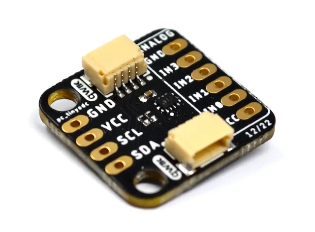

# ProtoCentral TLA20xx Arduino Library

[](https://github.com/Protocentral/protocentral_tla20XX_arduino/actions/workflows/arduino-lint.yml)
[](https://github.com/Protocentral/protocentral_tla20XX_arduino/actions/workflows/compile-examples.yml)

Arduino library for the ProtoCentral tinyADC breakout board — a tiny, low-power 12-bit delta-sigma ADC based on the Texas Instruments TLA2021/TLA2022/TLA2024.

## Don't have one? [Buy it here](https://protocentral.com/product/protocentral-tinyadc-tla2024-12-bit-delta-sigma-adc-breakout-board-qwiic-stemma-qt/)



The [Texas Instruments TLA20xx](https://www.ti.com/product/TLA2024) family are some of the smallest high-performance 12-bit sigma-delta analog-to-digital converters available, with an integrated voltage reference and programmable gain amplifier (PGA). The sigma-delta architecture delivers high resolution and excellent linearity, while sampling at up to 3.3 kSPS — ideal for data acquisition, measurement, and control. A wide 2 V to 5.5 V supply means it interfaces directly with 3.3 V or 5 V systems such as an Arduino without level shifters. The ProtoCentral tinyADC and tinyGSR breakout boards use this ADC for data acquisition.

This single library drives the whole register-compatible family:

| Device   | Inputs                          | PGA | MUX |
|----------|---------------------------------|:---:|:---:|
| TLA2021  | 1 differential (AIN0/AIN1)      |  –  |  –  |
| TLA2022  | 1 differential (AIN0/AIN1)      | yes |  –  |
| TLA2024  | 4 single-ended / 2 differential | yes | yes |

## Features

- 12-bit sigma-delta ADC with integrated voltage reference
- 4 single-ended or 2 fully differential inputs (TLA2024; one differential input on TLA2021/2022)
- Programmable gain amplifier: ±6.144 V down to ±0.256 V full-scale (0.125 mV/LSB)
- Programmable data rate: 128 SPS to 3300 SPS
- Continuous and single-shot (low-power) conversion modes
- Helpers for converting raw counts to millivolts / volts
- I²C / Qwiic / STEMMA QT interface, 2 V – 5.5 V operation
- Works with Arduino, ESP32, Nano 33 BLE, RP2040, and other 3.3 V / 5 V boards

## Installation

### Arduino Library Manager (Recommended)
1. Open Arduino IDE
2. Go to **Sketch → Include Library → Manage Libraries**
3. Search for "ProtoCentral TLA20xx"
4. Click **Install**

### Manual Installation
1. Download or clone this repository
2. Copy to your Arduino libraries folder (`~/Documents/Arduino/libraries/`)
3. Restart the Arduino IDE

## Hardware Setup

### Pin Connections

| Signal | Arduino UNO | ESP32 | Nano 33 BLE |
|--------|-------------|-------|-------------|
| VCC    | 3.3 V / 5 V | 3.3 V | 3.3 V       |
| GND    | GND         | GND   | GND         |
| SDA    | A4          | 21    | SDA         |
| SCL    | A5          | 22    | SCL         |

The ProtoCentral tinyADC has Qwiic / STEMMA QT connectors and on-board pull-ups, so no extra wiring is needed when daisy-chained on a Qwiic bus.

### I²C Address

The address is set by the ADDR pin. The tinyADC ships with ADDR tied to VDD, so it answers at `0x49` (the library default). Pass a different constant to the constructor for other straps.

| ADDR pin | I²C address | Constant                          |
|:--------:|:-----------:|-----------------------------------|
| GND      | `0x48`      | `TLA20XX_I2C_ADDR_GND`            |
| VDD      | `0x49`      | `TLA20XX_I2C_ADDR_VDD` (default)  |
| SDA      | `0x4A`      | `TLA20XX_I2C_ADDR_SDA`            |
| SCL      | `0x4B`      | `TLA20XX_I2C_ADDR_SCL`            |

### Analog Inputs

`AIN0`–`AIN3` accept single-ended signals (referenced to GND) on the TLA2024, or differential pairs (e.g. `AIN0`–`AIN1`) on any part. Keep every input within 0 V to VDD.

## Quick Start

```cpp
#include <Wire.h>
#include <protocentral_TLA20xx.h>

TLA20XX adc(TLA20XX_I2C_ADDR_VDD);   // 0x49 (tinyADC default)

void setup() {
    Serial.begin(115200);
    Wire.begin();

    if (!adc.begin()) {
        Serial.println("TLA20xx not found");
        while (1);
    }

    adc.setMode(TLA20XX::OP_CONTINUOUS);
    adc.setFSR(TLA20XX::FSR_2_048V);    // 1 mV / LSB
    adc.setDR(TLA20XX::DR_128SPS);
    adc.setMux(TLA20XX::MUX_AIN0_GND);  // single-ended AIN0
}

void loop() {
    Serial.print(adc.readADC());          // raw signed counts
    Serial.print('\t');
    Serial.println(adc.readVoltage(), 4); // volts, scaled by the active FSR
    delay(100);
}
```

## API Reference

### Constructor

```cpp
TLA20XX(uint8_t i2c_addr = TLA20XX_DEFAULT_ADDRESS, TwoWire *wire = &Wire);
```

### Initialization

| Method | Description |
|--------|-------------|
| `begin()`        | Probe the bus and load a default configuration; returns `false` if the device does not respond |
| `isConnected()`  | Returns `true` if the device ACKs at its I²C address |

### Configuration

| Method | Description |
|--------|-------------|
| `setFSR(fsr)` / `getFSR()`   | Full-scale range / PGA gain (`FSR_6_144V` … `FSR_0_256V`) |
| `setDR(rate)` / `getDR()`    | Output data rate (`DR_128SPS` … `DR_3300SPS`) |
| `setMux(mux)` / `getMux()`   | Input multiplexer, TLA2024 (`MUX_AIN0_AIN1` … `MUX_AIN3_GND`) |
| `setMode(mode)` / `getMode()`| Continuous (`OP_CONTINUOUS`) or single-shot (`OP_SINGLE`) |
| `getConfig()`                | Cached CONFIG register word |

### Reading Data

| Method | Description |
|--------|-------------|
| `readADC()`              | Signed 12-bit counts from the active input |
| `readMillivolts()`       | Counts scaled to millivolts by the active FSR |
| `readVoltage()`          | Counts scaled to volts |
| `startSingleConversion()`| Trigger one conversion (single-shot) |
| `isConversionReady()`    | `true` once the conversion has completed |
| `readADC_SingleShot()`   | Trigger one conversion, wait, and return the result |

### Conversions & Raw Access

| Method | Description |
|--------|-------------|
| `getLSBmV()`               | Millivolts per LSB for the active FSR |
| `toMillivolts(counts)`     | Convert a raw count to millivolts |
| `readRegister(reg)`        | Read a raw 16-bit register |
| `writeRegister(reg, value)`| Write a raw 16-bit register |

## Examples

| Example | Description |
|---------|-------------|
| `01.SingleEnded_Read`    | Read AIN0 vs GND in volts (TLA2024) |
| `02.Differential_Read`   | Read AIN0–AIN1 differentially in millivolts (all parts) |
| `03.AllChannels_Scan`    | Walk all four single-ended channels via the MUX (TLA2024) |
| `04.Gain_and_DataRate`   | Sweep every PGA range and show the LSB size / data-rate trade-off |
| `05.SingleShot_LowPower` | One-shot conversions with power-down between samples |
| `06.OpenView_Streaming`  | Stream AIN0/AIN1 to [ProtoCentral OpenView](https://github.com/Protocentral/protocentral_openview) in ADS1292R-compatible packet format |

## Build Script

A helper script for command-line builds with `arduino-cli` is included (Arduino Uno by default):

```bash
./build.sh list                          # List available examples
./build.sh compile                       # Compile every example
./build.sh compile -e 01.SingleEnded_Read # Compile one example
./build.sh upload  -e 01.SingleEnded_Read # Compile, upload, open the monitor
```

## Visualizing Output

Use the Arduino Serial Plotter for quick waveform inspection, or [ProtoCentral OpenView](https://github.com/Protocentral/protocentral_openview) for a richer multi-channel viewer (works with example `06.OpenView_Streaming`).

## Documentation

- [TI TLA2024 product page & datasheet](https://www.ti.com/product/TLA2024)
- [ProtoCentral tinyADC product page](https://protocentral.com/product/protocentral-tinyadc-tla2024-12-bit-delta-sigma-adc-breakout-board-qwiic-stemma-qt/)

## License

**Hardware:** [CERN-OHL-P v2](https://ohwr.org/cern_ohl_p_v2.txt)

**Software:** [MIT License](http://opensource.org/licenses/MIT)

**Documentation:** [Creative Commons Share-alike 4.0 International](http://creativecommons.org/licenses/by-sa/4.0/) 

Copyright (c) 2022 ProtoCentral Electronics. See [LICENSE.md](LICENSE.md) for details.

## Support

- GitHub Issues: https://github.com/Protocentral/protocentral_tla20XX_arduino/issues
- ProtoCentral: https://protocentral.com
